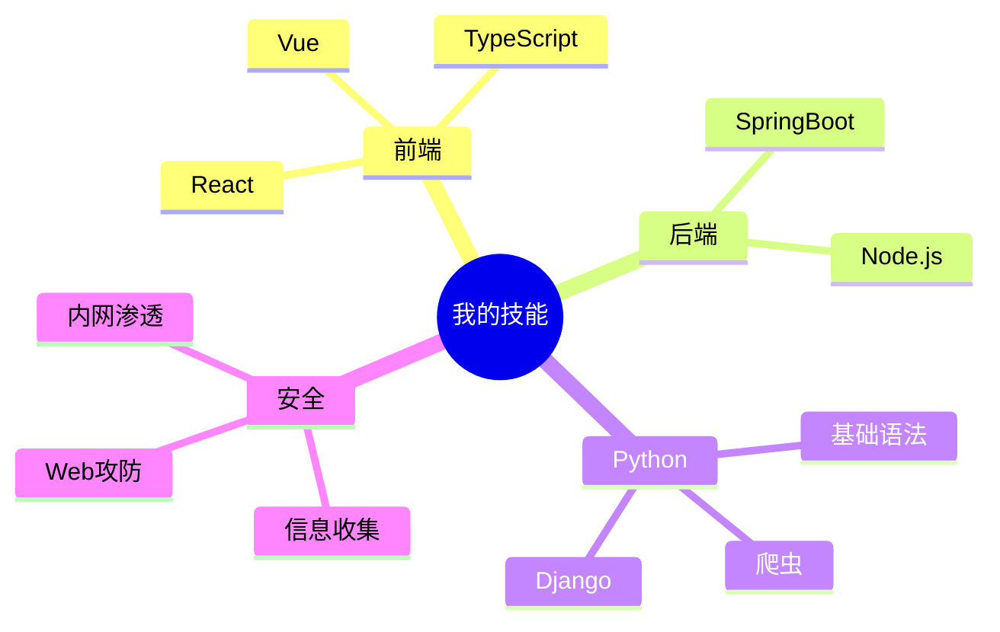

# 欢迎来到我的学习笔记

> 记录学习过程，分享技术心得。涵盖前端、后端、Python、网络安全、数据建模等领域。

## 关于我

- 全栈开发者
- 热爱学习与分享
- 持续更新中...

## 技能树

## 学习分类

- :fontawesome-brands-react: **前端开发**
  { .card-heading }
  React / Vue / TypeScript / 工程化
  [浏览前端笔记 &rarr;](front-end/index.md)

- :fontawesome-brands-java: **后端开发**
  { .card-heading }
  SpringBoot / RabbitMQ / ElasticSearch
  [浏览后端笔记 &rarr;](back-end/index.md)

- :fontawesome-brands-python: **Python**
  { .card-heading }
  基础语法 / 爬虫 / Django / 数据分析
  [浏览 Python 笔记 &rarr;](python/index.md)

- :fontawesome-solid-shield-halved: **网络安全**
  { .card-heading }
  信息收集 / Web 攻防 / 内网渗透
  [浏览安全笔记 &rarr;](net-sec/index.md)

- :fontawesome-solid-chart-line: **数学建模**
  { .card-heading }
  数据分析 / 评价 / 预测 / 优化 / 分类
  [浏览建模笔记 &rarr;](math-model/index.md)

- :fontawesome-solid-rocket: **实战项目**
  { .card-heading }
  爬虫实战 / 自动化项目
  [浏览项目笔记 &rarr;](projects/index.md)

- :fontawesome-solid-book-open: **教程**
  { .card-heading }
  环境搭建 / 工具使用
  [浏览教程 &rarr;](tutorials/index.md)

- :fontawesome-solid-screwdriver-wrench: **工具**
  { .card-heading }
  Git / Docker / Linux
  [浏览工具笔记 &rarr;](tools/index.md)

## 最新博客

- [2026-10-14 关于这个网站](blog/posts/2026-10-14-hello-world.md)

---

**搜索知识，请使用右上角的搜索框。**
